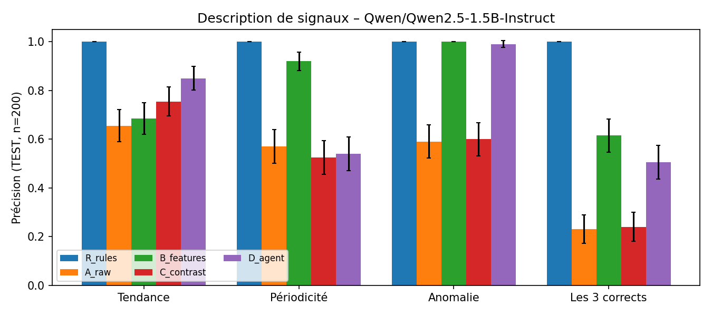
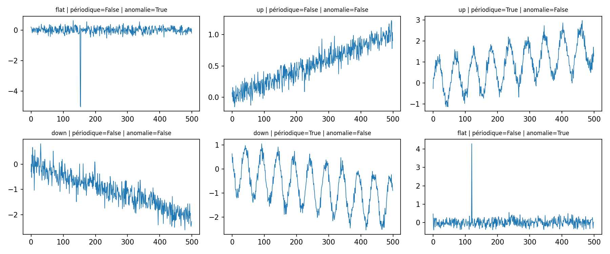

# Description de séries temporelles par un petit LLM : valeurs brutes, features, contraste et agent à outils

**Ghada Dakhlaoui** – Génie biomédical, INTeK (Tunisie) · Python · PyTorch / Transformers · Kaggle (GPU Tesla T4)

Projet personnel qui étudie une question liée à la description automatique de séries temporelles par modèles de langage : un petit LLM décrit-il mieux un signal quand on lui donne **des features statistiques ou des outils d'analyse** plutôt que **les valeurs brutes** ?

## Protocole

- **Données synthétiques avec vérité terrain** : 330 signaux de 500 points (30 DEV, 200 TEST, 100 de référence « normaux »). Chaque signal combine une tendance (monte / descend / plate), une composante périodique (oui/non, 4 à 12 cycles), une anomalie (un pic isolé, oui/non) et du bruit gaussien.
- **Modèle** : Qwen2.5-1.5B-Instruct (1,5 milliard de paramètres), décodage glouton (déterministe).
- **Sortie attendue** : un JSON avec `trend`, `periodic`, `anomaly` et une phrase de description. Les étiquettes sont comparées à la vérité terrain.
- **Features** (NumPy / SciPy) : pente totale et r² de la tendance, bruit résiduel robuste, fréquence dominante et part d'énergie spectrale, plus grand écart résiduel (en écarts-types robustes), nombre de points aberrants.
- **Réglage sur DEV, évaluation unique sur TEST** : les prompts ont été ajustés sur les 30 signaux DEV (trois itérations), puis le jeu TEST de 200 signaux a été évalué une seule fois.

### Méthodes comparées
| Code | Méthode |
|---|---|
| R | Règles à seuils sur les features (sans LLM, référence) |
| A | Le LLM reçoit les 500 valeurs brutes |
| B | Le LLM reçoit les features statistiques |
| C | B + comparaison à des signaux « normaux » de référence (plages observées) |
| D | Agent : le LLM appelle des outils (tendance, périodicité, anomalie), lit leurs résultats, puis répond |

## Résultats (jeu TEST : 200 signaux)

| Méthode | Tendance | Périodicité | Anomalie | Les 3 corrects | Réponses illisibles | s / signal |
|---|---|---|---|---|---|---|
| R : règles à seuils | 1,000 | 1,000 | 1,000 | 1,000 | 0 % | 0,001 |
| A : valeurs brutes | 0,655 | 0,570 | 0,590 | 0,230 ± 0,058 | 0 % | 3,6 |
| B : features | 0,685 | 0,920 | 1,000 | 0,615 ± 0,067 | 0 % | 2,4 |
| C : contraste | 0,755 | 0,525 | 0,600 | 0,240 ± 0,059 | 0 % | 3,8 |
| D : agent à outils | 0,850 | 0,540 | 0,990 | 0,505 ± 0,069 | 0 % | 4,7 |

Intervalles de confiance à 95 % (approximation binomiale).

Exemples de signaux synthétiques et de leur vérité terrain :

**Lecture prudente**
- Donner des features (B) ou des outils qui les calculent (D) améliore nettement la description par rapport aux valeurs brutes (A) : 0,62 et 0,51 contre 0,23 pour les trois propriétés correctes. Les intervalles ne se chevauchent pas avec A.
- B et D ne sont pas distinguables sur l'exactitude globale (0,62 contre 0,51, intervalles qui se chevauchent). D est meilleur sur la tendance (0,85) et B sur la périodicité (0,92 contre 0,54).
- La comparaison avec les signaux de référence (C) n'apporte pas de gain : 0,24, comparable aux valeurs brutes. L'explication possible (formulation « au-dessus de la plage normale » qui induit le modèle en erreur) n'a pas été testée.
- La règle à seuils trouve 100 % : la tâche est facile pour un code déterministe. Le point faible est la lecture des mesures par un petit LLM.

## Analyse des erreurs (jeu TEST, 200 signaux : nombre d'erreurs par propriété)

| Méthode | Tendance | Périodicité | Anomalie | Illisible |
|---|---|---|---|---|
| A : valeurs brutes | 69 | 86 | 82 | 0 |
| B : features | 63 | 16 | 0 | 0 |
| C : contraste | 49 | 95 | 80 | 0 |
| D : agent | 30 | 92 | 2 | 0 |

- **Périodicité** : A, C et D sont proches du hasard (environ la moitié des signaux sont périodiques), alors que B ne se trompe que 16 fois. C et D reçoivent tous deux la comparaison « dans / au-dessus de la plage normale » et B ne la reçoit pas. C'est cohérent avec l'hypothèse que cette formulation brouille le petit modèle sur la périodicité, mais elle n'est pas testée isolément (D diffère aussi de B par le dialogue en plusieurs tours).
- **Anomalie** : B ne fait aucune erreur et D en fait 2 ; A et C se trompent dans 40 % des cas.
- **Tendance** : l'agent D est le meilleur (30 erreurs) ; B se trompe 63 fois, vraisemblablement sur les pentes faibles ou sur les signaux plats périodiques (non vérifié signal par signal).

## Limites
- **L'agent n'est pas adaptatif** : il appelle les trois outils pour chaque signal (3,0 appels en moyenne, aucun repli). Ce n'est pas une sélection d'outils.
- Signaux synthétiques seulement (pas de données industrielles réelles), un seul modèle de petite taille, une seule exécution déterministe.
- Prompts réglés sur 30 signaux DEV en trois itérations : un format qui plaçait la description avant les étiquettes a dégradé les résultats et a été abandonné.
- Pas de comparaison avec des modèles spécialisés (ChatTS, etc.) ni avec des modèles plus grands.
- Évaluation limitée à trois étiquettes ; la qualité de la phrase de description n'est pas mesurée.

## Pistes
Modèle plus grand (Qwen2.5-3B ou 7B), sélection réellement adaptative des outils, signaux réels (ECG, EEG, capteurs industriels), évaluation de la qualité des descriptions, plusieurs graines et validation croisée.

## Reproduire
1. Kaggle avec GPU T4 et Internet activé.
2. Importer `TSLM_Projet_Complet_KAGGLE.ipynb` et exécuter toutes les cellules (environ 1 h 15 : chargement du modèle, essai DEV, évaluation TEST).
3. Les résultats sont écrits dans `/kaggle/working` (`results_test.csv`, `predictions_test.json`, figures).

Graine 42. Dépendances : voir `requirements.txt`.
